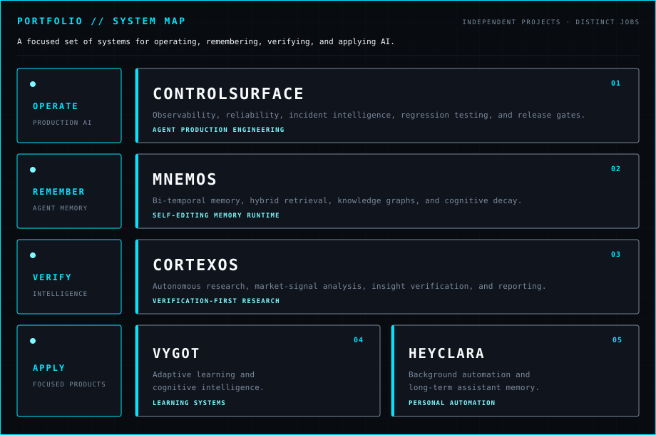

<!--
  DevChiniwala / DevChiniwala
  Applied AI systems portfolio · cyan on near-black
-->

<div align="center">

<a href="https://github.com/DevChiniwala">
  
</a>

<p>
  <a href="https://www.linkedin.com/in/dev-chiniwala/"><code>LinkedIn</code></a>
  · <a href="https://x.com/DevChiniwala"><code>X / Twitter</code></a>
  · <a href="mailto:dev.chiniwala@gmail.com"><code>Email</code></a>
  · <a href="https://github.com/DevChiniwala?tab=repositories"><code>Repositories</code></a>
</p>

</div>


## 01 / Flagship systems

Three public systems showing how I approach production AI: instrument the runtime, preserve changing state, and verify generated intelligence.

### 01 — ControlSurface / Agent production engineering

<a href="https://github.com/DevChiniwala/ControlSurface">
  
</a>

**Production failures should become reusable engineering evidence.** ControlSurface derives agent execution structure from traces, turns recurring failures into reviewed regression cases, and attaches deterministic evidence to release decisions.

[Repository](https://github.com/DevChiniwala/ControlSurface) · [Architecture](https://github.com/DevChiniwala/ControlSurface/blob/main/ARCHITECTURE.md) · [v0.1.0-rc.1](https://github.com/DevChiniwala/ControlSurface/releases/tag/v0.1.0-rc.1)<br/>
<code>Python</code> <code>OpenTelemetry</code> <code>PostgreSQL</code> <code>ClickHouse</code> <code>Next.js</code> <code>Docker Compose</code>

### 02 — MNEMOS / Temporal memory

<a href="https://github.com/DevChiniwala/MNEMOS">
  
</a>

**Memory should preserve both change and provenance.** MNEMOS resolves new facts through explicit lifecycle operations, combines six retrieval signals, and keeps context bounded through consolidation, decay, and token-aware packing.

[Repository](https://github.com/DevChiniwala/MNEMOS) · [Package metadata](https://github.com/DevChiniwala/MNEMOS/blob/main/pyproject.toml) · [Documentation](https://github.com/DevChiniwala/MNEMOS/tree/main/docs)<br/>
<code>Python</code> <code>MCP</code> <code>FastAPI</code> <code>Neo4j</code> <code>FAISS</code> <code>RAGAS</code>

### 03 — CortexOS / Verified intelligence

<a href="https://github.com/DevChiniwala/CortexOS">
  
</a>

**Generated intelligence is useful when its claims can be inspected.** CortexOS combines multi-agent research with a deterministic Rust verification path and a local Tauri application backed by SQLite.

[Repository](https://github.com/DevChiniwala/CortexOS) · [Frontend manifest](https://github.com/DevChiniwala/CortexOS/blob/main/package.json) · [Rust core](https://github.com/DevChiniwala/CortexOS/blob/main/src-tauri/Cargo.toml)<br/>
<code>React</code> <code>TypeScript</code> <code>Tauri</code> <code>Rust</code> <code>Tokio</code> <code>SQLite</code>


## 02 / Applied systems

### 04 — VYGOT / Adaptive learning



VYGOT is a private team project exploring personalized learning intelligence. Product and implementation details remain limited until its public launch.

### 05 — HeyClara / Always-on personal agent

<a href="https://github.com/DevChiniwala/HeyClara">
  
</a>

**A personal agent should continue useful work between conversations.** HeyClara runs scheduled jobs with persistent workspaces, consolidates memory in two stages, and exposes shared MCP tools across Telegram, Slack, voice, and SMS.

[Repository](https://github.com/DevChiniwala/HeyClara) · [npm package](https://www.npmjs.com/package/@devchiniwala/heyclara) · [Documentation](https://github.com/DevChiniwala/HeyClara/tree/main/docs)<br/>
<code>Bun</code> <code>TypeScript</code> <code>Claude Agent SDK</code> <code>MCP</code> <code>PostgreSQL</code> <code>Zod</code>


## 03 / System portfolio



Each project is an independent system. The map describes the engineering surface each one owns without implying a shared runtime.


## 04 / Open-source engineering

I have contributed **70+ merged pull requests** across AI infrastructure, developer tooling, retrieval systems, data platforms, and cross-platform reliability.

| Selected contribution | Engineering change |
|---|---|
| [Reticle #1286](https://github.com/reticlehq/reticle/pull/1286) | Preserved declared network URLs through browser action replay. |
| [ChunkHound #419](https://github.com/chunkhound/chunkhound/pull/419) | Replaced embedding full-table scans with targeted SQL. |
| [HelixDB #1164](https://github.com/HelixDB/helix-db/pull/1164) | Validated signed 64-bit values across generated SDKs. |
| [DataMind #21](https://github.com/OpenDCAI/DataMind/pull/21) | Redacted secrets from audit errors. |

[Browse all merged contributions →](https://github.com/search?q=is%3Apr+author%3ADevChiniwala+is%3Amerged&type=pullrequests)


## 05 / AI systems stack




## 06 / Engineering principles



The panel paraphrases ideas from [A Philosophy of Software Design](https://web.stanford.edu/~ouster/cgi-bin/book.php), [Designing Data-Intensive Applications](https://dataintensive.net/), [Accelerate](https://itrevolution.com/product/accelerate/), and [Site Reliability Engineering](https://sre.google/books/).


## 07 / Live GitHub telemetry

<a href="https://github.com/DevChiniwala?tab=repositories">
  
</a>

Generated daily from GitHub's public REST API. Repository and star totals are scoped in the panel; language share uses owned, non-fork public repositories. [Generator](./scripts/update-profile-telemetry.mjs) · [Workflow](./.github/workflows/update-profile-telemetry.yml)

<picture>
  <source media="(prefers-color-scheme: dark)" srcset="https://raw.githubusercontent.com/DevChiniwala/DevChiniwala/output/github-snake-dark.svg"/>
  <source media="(prefers-color-scheme: light)" srcset="https://raw.githubusercontent.com/DevChiniwala/DevChiniwala/output/github-snake.svg"/>
  
</picture>


## 08 / Connect

<div align="center">

I build the systems around AI models: data, memory, evaluation, runtimes, and product delivery.

```bash
npx devcard0707
```

<a href="https://www.linkedin.com/in/dev-chiniwala/"><code>LinkedIn</code></a>
· <a href="https://x.com/DevChiniwala"><code>X / Twitter</code></a>
· <a href="mailto:dev.chiniwala@gmail.com"><code>Email</code></a>
· <a href="https://github.com/DevChiniwala"><code>GitHub</code></a>

</div>
<!-- end profile -->
